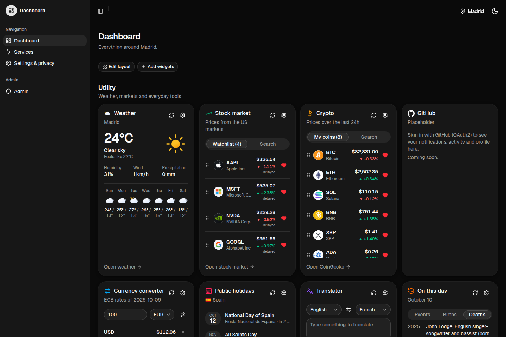

# Dashboard

A personal dashboard that gathers live information from public services into widgets you choose,
configure and arrange. Each widget refreshes on its own schedule: the weather where you are, your
stocks and coins, the news you follow, today's puzzles, and more.

## AVAILABLE ONLINE ON VERCEL: [DASHBOARD](https://dashboard-jad-nico.vercel.app/)



## What it is for

- **One page for your morning check:** weather, markets, headlines and holidays at a glance.
- **Follow what you care about:** your own stock and crypto watchlists, news topics and keywords,
  currencies, languages.
- **A daily break:** Wordle, a flag guesser, Spelling Bee and 2048, with new puzzles every day.
- **The same dashboard everywhere:** your widgets and settings are saved to your account, not to
  one browser.

## Key features

- **14 widgets from 5 services**, each with its own options, set from the gear on the card.
- **Automatic refresh:** one timer drives the whole page; each widget refreshes at the rate you pick
  (never below the widget's minimum), and nothing runs while the tab is hidden.
- **Your layout:** drag widgets to reorder them inside their section (mouse or keyboard), hide the
  ones you don't want, and add them back from "Add widgets".
- **Saved per user:** widgets, options, order, location, text size and theme live in the database.
- **Your location, with consent:** the weather, holidays and news follow your city. A city you pick
  always wins; your connection is only used to guess it after you say yes.
- **Your own API keys:** paste your own Finnhub key so your widgets don't share the app's free quota.
  It is stored encrypted (AES-256-GCM) and only its last 4 characters are ever shown back.
- **Privacy built in:** a privacy notice, every cookie explained, and "Download my data" in Settings.
- **Fast and resilient:** answers are cached and shared between users; when a service is down you
  get its last good answer instead of an error.
- **Accessibility:** keyboard navigation everywhere, screen reader announcements, and a text size
  setting.
- **Light, dark or system theme.**

## Services and widgets

| Service      | Account or key           | Widget               | Parameters                                                         |
| ------------ | ------------------------ | -------------------- | ------------------------------------------------------------------ |
| Weather      | No                       | `current_weather`    | `city` (empty = your location), `units`, `show_wind`, `days` (0–7) |
| Stock market | App key, or your own key | `stock_watchlist`    | `tickers` (up to 10 US stocks), `change` (percent or amount)       |
|              |                          | `crypto_prices`      | `coins` (up to 15 CoinGecko ids), `currency` (usd, eur, gbp)       |
|              |                          | `currency_converter` | `from`, `to` (comma list), `amount`                                |
| Tools        | No                       | `public_holidays`    | `country` (empty = yours), `count`                                 |
|              |                          | `translator`         | `from`, `to` (12 languages)                                        |
|              |                          | `on_this_day`        | `type` (events, births, deaths), `count`, `language`               |
| News         | No                       | `headlines`          | `topics`, `keywords`, `country`, `language`, `count`               |
|              |                          | `world_events`       | `window` (day or week), `min_magnitude`, `show_natural`            |
|              |                          | `live_tv`            | `channel` (Al Jazeera, DW, Sky News, Bloomberg)                    |
| Games        | No                       | `wordle`             | `length`, `hard_mode`                                              |
|              |                          | `flag_guesser`       | `tries`, `hints`                                                   |
|              |                          | `spelling_bee`       | `min_length`                                                       |
|              |                          | `game_2048`          | `size` (3–6), `target` (1024, 2048, 4096)                          |

The full, always up to date list (services, widgets, parameters and their types) is served at
`/about.json`, generated from the same definitions the server validates with.

**Where the data comes from:** Open-Meteo (weather), Finnhub (stocks), CoinGecko (crypto),
Frankfurter / European Central Bank (currencies), Nager.Date (holidays), MyMemory (translation),
Wikipedia (on this day), Google News (headlines), USGS and NASA EONET (world events), YouTube
(live TV), Datamuse, flagcdn and CountriesNow (games). Our server calls them; your browser never does.

## How to use it

1. **Open the dashboard.** Your widgets are grouped in three sections: Utility, News and Games.
2. **Set your location** with the pin in the top bar: search a city, or use your device position
   (you see what it is used for before your browser asks). Or answer "yes" to the question on the
   dashboard to let us guess your city from your connection.
3. **Configure a widget** with its gear: its refresh rate and its options. Some options are on the
   card itself: heart a stock or a coin, pick a currency, a language or a TV channel.
4. **Arrange the page** with **Edit layout**: drag a card, or tab to it and use Space and the arrows.
   The cross hides a card. **Add widgets** turns any widget on or off.
5. **Settings & privacy** (sidebar): location, text size, theme, download your data, and the privacy
   notice.
6. **Services** (sidebar): what each service needs, and the form for your own API key.

> **Accounts:** sign-up with email confirmation and sign-in are being merged (`feat/accounts`).
> Until then the online version shows the default dashboard, read-only. Locally, the per-user
> features work with the seeded demo account (see below).

## Screenshots

<table>
  <tr>
    <td width="50%"><br><sub><b>News:</b> world events map, live TV and headlines</sub></td>
    <td width="50%"><br><sub><b>Games:</b> new daily puzzles for everyone</sub></td>
  </tr>
  <tr>
    <td width="50%"><br><sub><b>Widget settings:</b> refresh rate and options, generated from the widget's schema</sub></td>
    <td width="50%"><br><sub><b>Edit layout:</b> drag to reorder, the cross hides a card</sub></td>
  </tr>
  <tr>
    <td width="50%"><br><sub><b>Add widgets:</b> one switch per widget, settings kept</sub></td>
    <td width="50%"><br><sub><b>Services:</b> what each one needs, and your own API key</sub></td>
  </tr>
  <tr>
    <td width="50%"><br><sub><b>Settings &amp; privacy:</b> location, display, download your data</sub></td>
  </tr>
</table>

## Run it

### With Docker (the whole app, nothing else to install)

```bash
docker-compose build
docker-compose up
```

The app answers on http://localhost:8080 and the database migrations run on startup.
`http://localhost:8080/about.json` lists the services and widgets.

Optional, from the shell or a root `.env`:

| Variable          | What for                                                                                      |
| ----------------- | --------------------------------------------------------------------------------------------- |
| `FINNHUB_API_KEY` | Live stock prices (free key at finnhub.io). Without it, the stock card says so.               |
| `CREDENTIALS_KEY` | Encrypts the keys users save (`openssl rand -base64 32`). A public demo key is used if empty. |

### For development

Requirements: Node.js 22 or later (see `.nvmrc`), Docker and Docker Compose.

```bash
npm install
npm run setup
npm run dev
```

`npm run setup` creates `.env.local` (with a fresh `CREDENTIALS_KEY`), starts Postgres in Docker,
applies the migrations and seeds two accounts. It is safe to rerun, and it is also how you start the
database again after a reboot. To stop it: `docker compose -f docker-compose.dev.yml down`.

| Account | Email                  | Password              |
| ------- | ---------------------- | --------------------- |
| Admin   | `admin@dashboard.test` | `dashboard-admin-dev` |
| Demo    | `demo@dashboard.test`  | `dashboard-demo-dev`  |

These accounts only exist in your local database. The seed refuses to run against anything else.
With `DEV_USER_EMAIL=demo@dashboard.test` in `.env.local`, every local request acts as the demo user.

The API lives under `/api`. Its reference is at http://localhost:3000/api/docs and the OpenAPI
document at http://localhost:3000/api/openapi.json, both generated from the schemas the server
validates with.

### Build for production

```bash
npm run build
npm run start
```

The server refuses to start without a valid `CREDENTIALS_KEY`. On Vercel, the migrations run before
each production build (`vercel.json`).

### Tests

```bash
npm test
```

Vitest runs against a separate test database (port 55434, started by `npm run setup`), with every
outside service faked by Mock Service Worker, so the tests never touch your data or the network.

## Scripts

| Script               | What it does                                               |
| -------------------- | ---------------------------------------------------------- |
| `npm run setup`      | Env file, database, migrations and seed                    |
| `npm run dev`        | Development server on port 3000                            |
| `npm run build`      | Production build                                           |
| `npm run start`      | Serve the production build                                 |
| `npm test`           | Run the tests (with type checks)                           |
| `npm run db:migrate` | Create and apply a migration after a schema change         |
| `npm run db:reset`   | Wipe the local database, reapply the migrations and reseed |
| `npm run db:studio`  | Browse the database in Prisma Studio                       |
| `npm run lint`       | ESLint                                                     |
| `npm run typecheck`  | Generate route types, then `tsc`                           |
| `npm run format`     | Format with Prettier                                       |
| `npm run check`      | Lint, typecheck and format check                           |

## Technology and specifications

| Layer    | Technology                                                                      |
| -------- | ------------------------------------------------------------------------------- |
| Frontend | Next.js 16 (App Router), React 19, Tailwind CSS 4, shadcn/ui, dnd-kit, d3-geo   |
| API      | Hono with `@hono/zod-openapi`, mounted inside the Next.js app under `/api`      |
| Data     | PostgreSQL with Prisma 7 (Neon on Vercel, a container in Docker)                |
| Accounts | better-auth (email and password, email confirmation, OAuth for linked accounts) |
| Tests    | Vitest and Mock Service Worker                                                  |
| Hosting  | Vercel (production), Docker Compose (the graded stack, port 8080)               |

**How it works**

- **One app, two parts:** the pages are rendered by Next.js; everything under `/api` is answered by
  Hono. The browser only displays data and sends requests; the server does the work.
- **A widget registry:** each widget is declared once, with its options as a zod schema. That one
  definition produces `/about.json`, validates every request and every saved widget, draws the
  widget's settings window and fills in a new widget's defaults.
- **One pipeline for every widget:** options checked, answer taken from the cache or fetched with an
  8 s timeout, then checked against the widget's answer schema before it is sent.
- **Shared cache:** in memory, then in a database table shared by every server instance; identical
  requests share one outside call; each widget sets how long its answer stays fresh.
- **Rate limit:** 150 widget requests a minute per user (or IP), with `429` and `Retry-After` above it.
- **Security:** every query is scoped to the signed-in user, errors never leak internals, cookies are
  `HttpOnly`, user API keys are sealed with AES-256-GCM, and the IP location needs consent (GDPR).
- **The timer:** one schedule for the whole page, a tick every second; each widget runs at its saved
  rate, with a small random delay so widgets don't all refresh at once.

## Project structure

```
app/          pages (dashboard, services, settings) and the /api entry
components/   widget cards, the dashboard, settings, shadcn/ui parts
lib/          browser and shared code: the API client, the timer
server/       the Hono API, the widget registry, services, cache, rate limit, encryption
prisma/       database schema and migrations
tests/        Vitest tests and the fake services
```
