# Dashboard

A personal dashboard that gathers live information from public services into widgets you choose,
configure and arrange. Each widget refreshes on its own schedule: the weather where you are, your
stocks and coins, the news you follow, today's puzzles, and more.

## ACCESS THE [DASHBOARD](https://dashboard-jad-nico.vercel.app/)

https://github.com/user-attachments/assets/1afa7ca5-6ad4-4166-beed-344738a4560a

## What it is for

- **One page for your morning check:** weather, markets, headlines and holidays at a glance.
- **Follow what you care about:** your own stock and crypto watchlists, news topics and keywords,
  currencies, languages.
- **A daily break:** Wordle, a flag guesser, Spelling Bee and 2048, with new puzzles every day.
- **The same dashboard everywhere:** your widgets and settings are saved to your account, not to
  one browser.

## Key features

- **16 widgets from 7 services**, each with its own options, set from the gear on the card.
- **Your GitHub, through OAuth2:** connect your GitHub account on the Services page to see your
  unread notifications and your public repositories. Read only; the token is stored encrypted and
  disconnecting deletes it.
- **Automatic refresh:** one timer drives the whole page; each widget refreshes at the rate you pick
  (never below the widget's minimum), and nothing runs while the tab is hidden.
- **Your layout:** add any widget as many times as you want, each copy with its own settings (a
  weather for Madrid and one for Paris), drag widgets to reorder them inside their section (mouse or
  keyboard), and remove the ones you don't want, with an undo.
- **Saved per user:** widgets, options, order, location, text size and theme live in the database.
- **Your location, with consent:** the weather, holidays and news follow your city. A city you pick
  always wins; your connection is only used to guess it after you say yes.
- **Your own API keys:** paste your own Finnhub key so your widgets don't share the app's free quota.
  Finnhub checks it before it's saved, it is stored encrypted (AES-256-GCM) and only its last 4
  characters are ever shown back.
- **Your account, your way:** change your name, username or email, change your password, sign out
  of every device, see your saved keys and the accounts you log in with, and remove any of them.
  Your Google picture is used as your avatar. Forgot your password? A link by email lets you pick a
  new one.
- **Protected logins:** on top of the usual per IP limit, each account allows 10 login attempts
  every 15 minutes, whatever the IP they come from.
- **An admin page:** admins see every user, and can promote, demote, ban and unban them.
- **Privacy built in:** a privacy notice, every cookie explained, and "Download my data" in Settings.
- **Fast and resilient:** answers are cached and shared between users; when a service is down you
  get its last good answer instead of an error.
- **Accessibility:** keyboard navigation everywhere, screen reader announcements, and a text size
  setting.
- **Light, dark or system theme.**

## Services and widgets

| Service      | Account or key           | Widget               | Parameters                                                         |
| ------------ | ------------------------ | -------------------- | ------------------------------------------------------------------ |
| Weather      | No                       | `current_weather`    | `city` (empty = your location), `units`, `show_wind`, `days` (0–7) |
| Stock market | App key, or your own key | `stock_watchlist`    | `tickers` (up to 10 US stocks), `change` (percent or amount)       |
| Currencies   | No                       | `crypto_prices`      | `coins` (up to 15 CoinGecko ids), `currency` (usd, eur, gbp)       |
|              |                          | `currency_converter` | `from`, `to` (comma list), `amount`                                |
| GitHub       | Your GitHub account      | `repositories`       | `count`, `sort` (pushed, created, full_name)                       |
|              | (OAuth2)                 | `notifications`      | `count`, `only_participating`                                      |
| Tools        | No                       | `public_holidays`    | `country` (empty = yours), `count`                                 |
|              |                          | `translator`         | `from`, `to` (12 languages)                                        |
|              |                          | `on_this_day`        | `type` (events, births, deaths), `count`, `language`               |
| News         | No                       | `headlines`          | `topics`, `keywords`, `country`, `language`, `count`               |
|              |                          | `world_events`       | `window` (day or week), `min_magnitude`, `show_natural`            |
|              |                          | `live_tv`            | `channel` (Al Jazeera, DW, Sky News, Bloomberg)                    |
| Games        | No                       | `wordle`             | `length`, `hard_mode`                                              |
|              |                          | `flag_guesser`       | `tries`, `hints`                                                   |
|              |                          | `spelling_bee`       | `min_length`                                                       |
|              |                          | `game_2048`          | `size` (3–6), `target` (1024, 2048, 4096)                          |

The full, always up to date list (services, widgets, parameters and their types) is served at
`/about.json`, generated from the same definitions the server validates with.

**Where the data comes from:** Open-Meteo (weather), Finnhub (stocks), CoinGecko (crypto), GitHub,
Frankfurter / European Central Bank (currencies), Nager.Date (holidays), MyMemory (translation),
Wikipedia (on this day), Google News (headlines), USGS and NASA EONET (world events), YouTube
(live TV), Datamuse, flagcdn and CountriesNow (games). Our server calls them; your browser never does.

## How to use it

1. **Create an account** on **Register**: name, username, email and a password of 12 characters or
   more (common passwords are refused). Click the link in the confirmation email, and you are signed
   in. Next time, log in with your username or your email. **Continue with Google** appears when the
   server has a Google client. **Forgot your password?** on the log in page emails you a link to
   choose a new one, valid 1 hour, and signs you out everywhere once it's changed.
2. **Open the dashboard.** Your widgets are grouped in three sections: Utility, News and Games.
   Everything except the privacy notice needs a confirmed account.
3. **Set your location** with the pin in the top bar: search a city, or use your device position
   (you see what it is used for before your browser asks). Or answer "yes" to the question on the
   dashboard to let us guess your city from your connection.
4. **Configure a widget** with its gear: its refresh rate and its options. Some options are on the
   card itself: heart a stock or a coin, pick a currency, a language or a TV channel. The daily
   puzzles have no refresh rate, a new one comes at midnight UTC.
5. **Add a widget** with **Add widget**: pick one, set its options and refresh rate, add it. The same
   widget can be added more than once.
6. **Arrange the page** with **Edit layout**: drag a card, or tab to it and use Space and the arrows.
   The cross removes a card; **Undo** puts it back for a few seconds.
7. **Settings & privacy** (sidebar): location, text size, theme, download your data, delete your
   account (confirmed by an email link), and the privacy notice. Also:
   - **Profile:** your name and username are saved right away. Your picture comes from Google, when
     you sign in with it or connect it. A new email takes 2 clicks: a link to your current address
     approves the change, then a link to the new address confirms it.
   - **Keys and connected accounts:** your saved API keys (last 4 characters only), how you log in
     (password, Google) and GitHub if linked. Remove a key, unlink an account or connect Google; your
     last way to log in can't be removed.
   - **Security:** change your password, which signs out your other devices, or **Sign out
     everywhere**, this device included.
8. **Services** (sidebar): what each service needs, and the form for your own API key.
9. **Admin** (sidebar, admins only): every user with their badges (admin, unverified, banned) and
   number of subscriptions, a search, and **Promote** / **Demote**, **Ban** (with a reason) and
   **Unban**. A banned user is signed out and can't log in. An admin can't demote or ban themselves.
10. **Log out** from your name at the bottom of the sidebar.

### Admin

There is no hardcoded admin: the first one is set by hand in the database, then they promote others
from `/admin`. Set `role` to `admin` on their user row:

- **Live site:** in the Neon SQL editor, run
  `UPDATE "user" SET role = 'admin' WHERE email = 'you@example.com';`
- **Docker:**
  `docker compose exec db psql -U dashboard -d dashboard -c "UPDATE \"user\" SET role = 'admin' WHERE email = 'you@example.com';"`

Then log out and back in. The **Admin** link appears in the sidebar, and the **Promote** button on
`/admin` makes the next admins. In development, the seeded `admin` account already is one.

## Screenshots

<table>
  <tr>
    <td width="50%">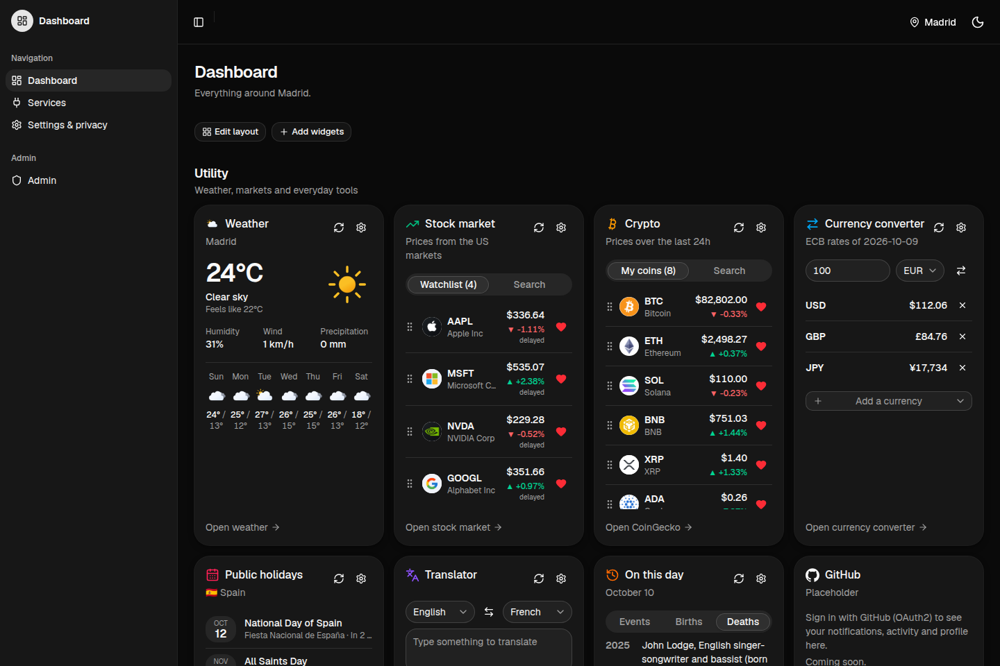<br><sub><b>Dashboard:</b> everything you follow, on one page</sub></td>
    <td width="50%">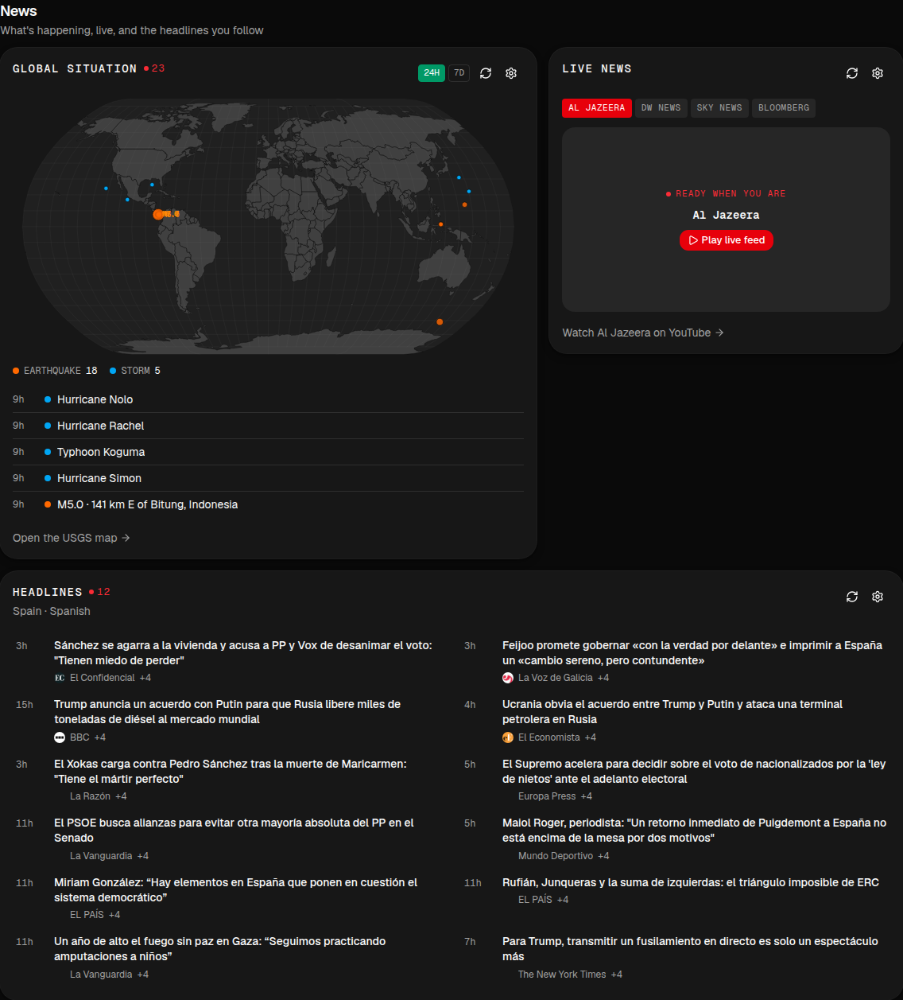<br><sub><b>News:</b> world events map, live TV and headlines</sub></td>
  </tr>
  <tr>
    <td width="50%">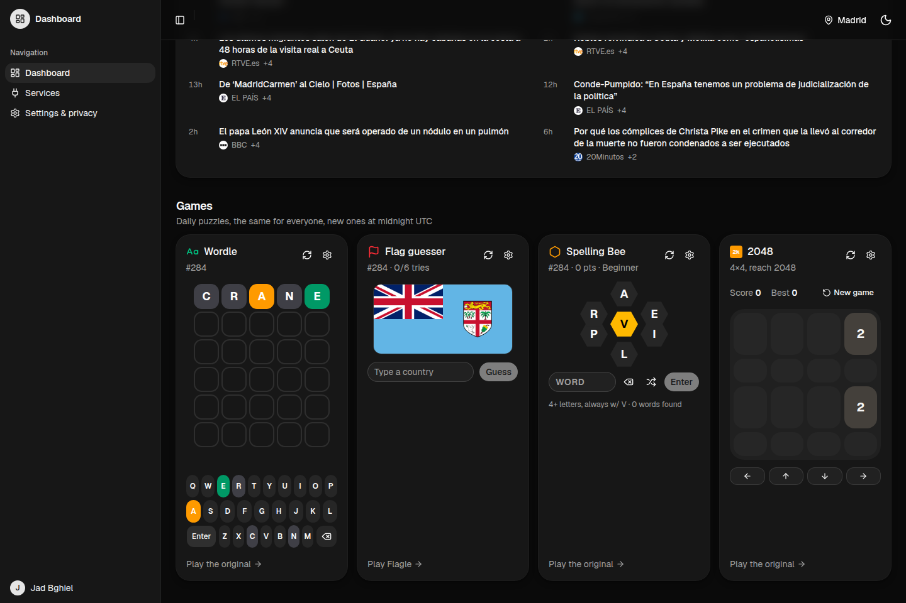<br><sub><b>Games:</b> new daily puzzles for everyone</sub></td>
    <td width="50%">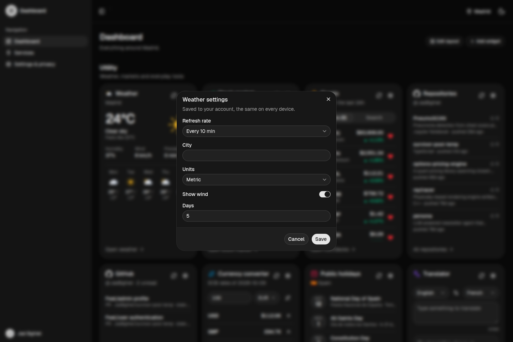<br><sub><b>Widget settings:</b> refresh rate and options, generated from the widget's schema</sub></td>
  </tr>
  <tr>
    <td width="50%">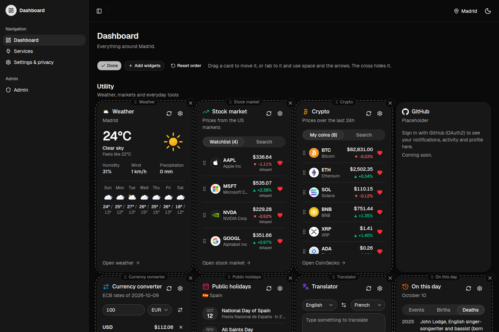<br><sub><b>Edit layout:</b> drag to reorder, the cross removes a card</sub></td>
    <td width="50%">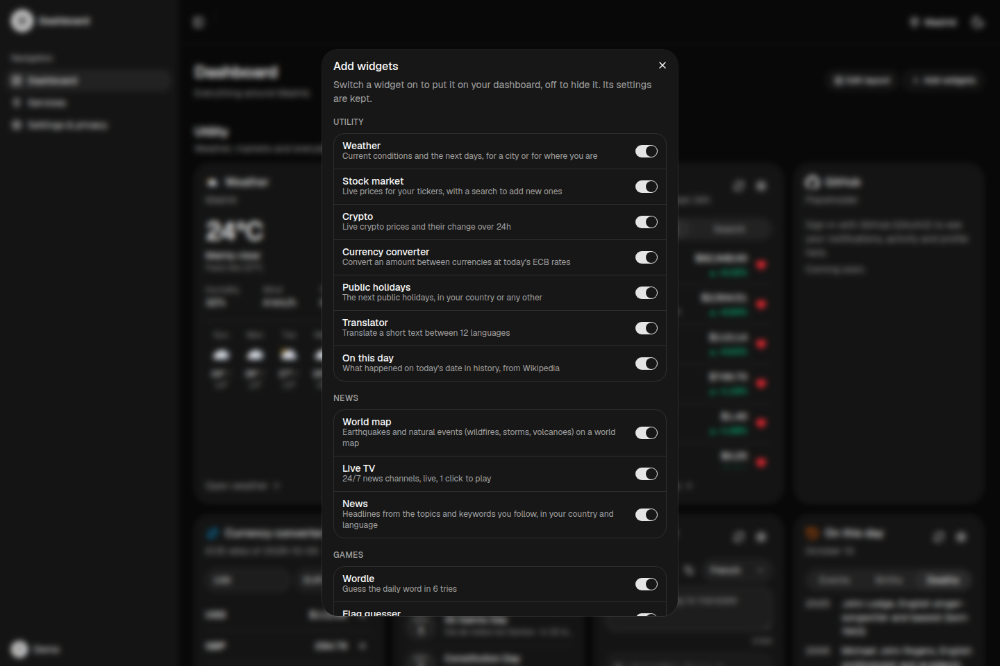<br><sub><b>Add widget:</b> pick a widget, set it up, add it, as many times as you want</sub></td>
  </tr>
  <tr>
    <td width="50%">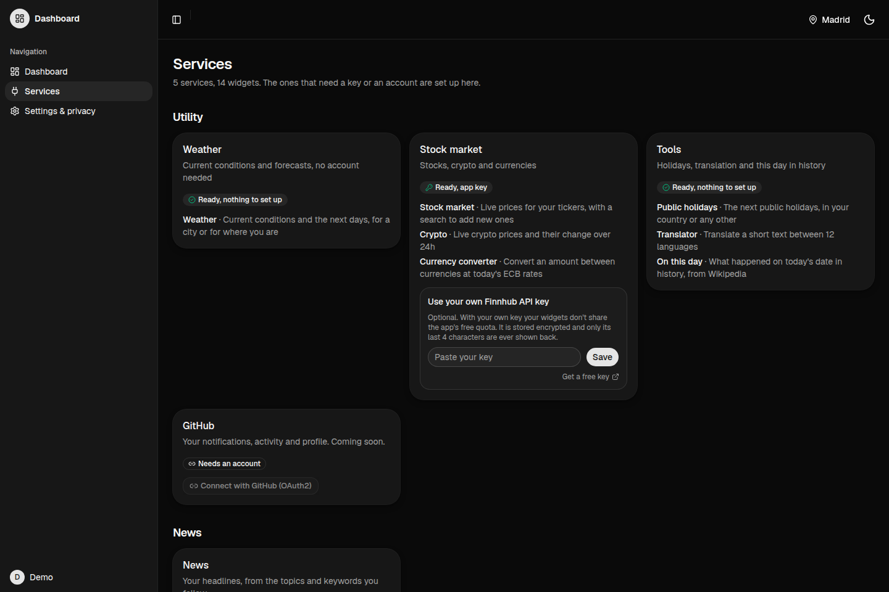<br><sub><b>Services:</b> your own API key, or connect GitHub</sub></td>
    <td width="50%">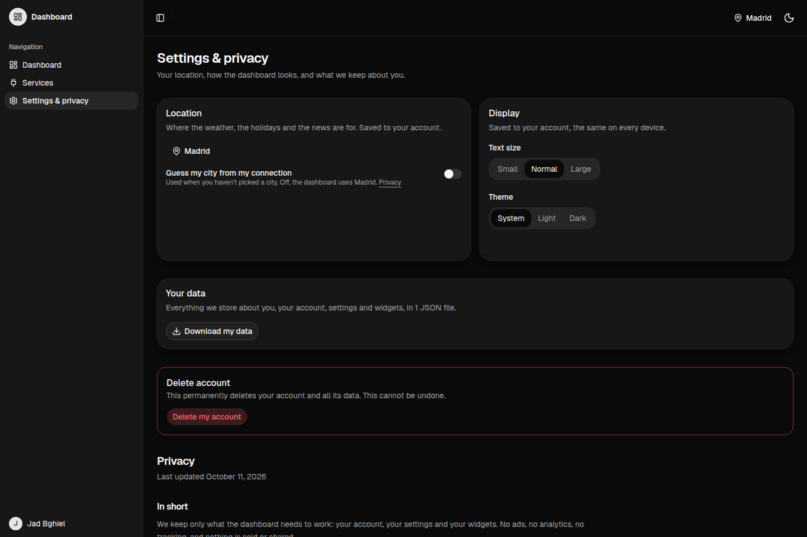<br><sub><b>Settings &amp; privacy:</b> location, display, your data, delete your account</sub></td>
  </tr>
  <tr>
    <td width="50%">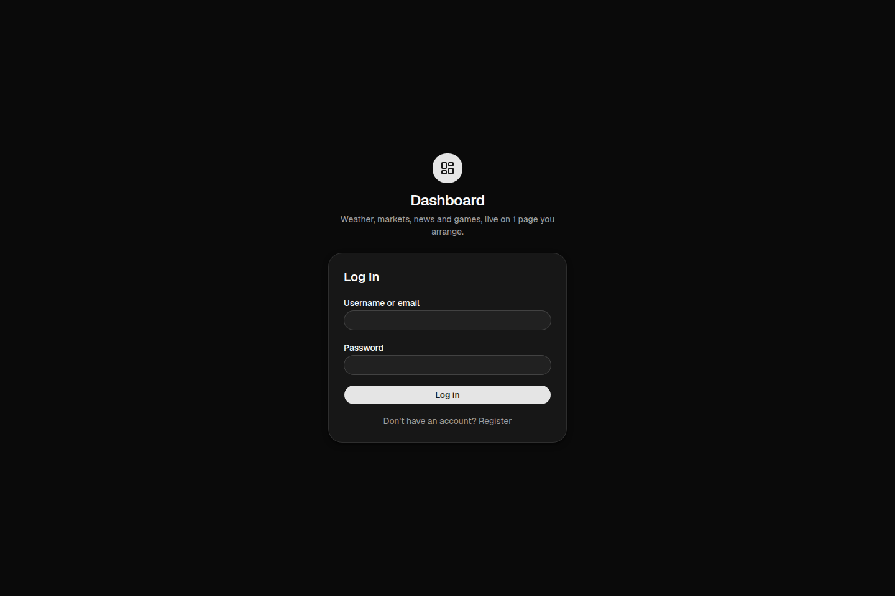<br><sub><b>Log in:</b> with your username or your email</sub></td>
    <td width="50%">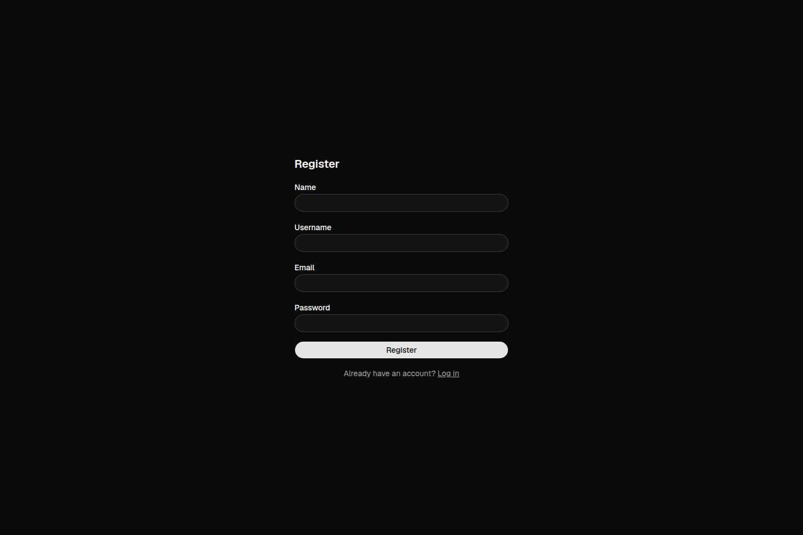<br><sub><b>Register:</b> confirmed by an email link</sub></td>
  </tr>
</table>

## Run it

### With Docker (the whole app, nothing else to install)

```bash
docker-compose build
docker-compose up
```

The app answers on http://localhost:8080 and the database migrations run on startup.
`http://localhost:8080/about.json` lists the services and widgets.

To create an account, register at http://localhost:8080/register. The confirmation email doesn't
leave your machine: open the inbox at **http://localhost:8025** (Mailpit) and click the link.

Optional, from the shell or a root `.env`:

| Variable                                   | What for                                                                                      |
| ------------------------------------------ | --------------------------------------------------------------------------------------------- |
| `FINNHUB_API_KEY`                          | Live stock prices (free key at finnhub.io). Without it, the stock card says so.               |
| `CREDENTIALS_KEY`                          | Encrypts the keys users save (`openssl rand -base64 32`). A public demo key is used if empty. |
| `GOOGLE_CLIENT_ID`, `GOOGLE_CLIENT_SECRET` | "Continue with Google". Without them, the button is hidden.                                   |

### For development

Requirements: Node.js 22 or later (see `.nvmrc`), Docker and Docker Compose.

```bash
npm install
npm run setup
npm run dev
```

`npm run setup` creates `.env.local` (with a fresh `CREDENTIALS_KEY`), starts Postgres and Mailpit in
Docker, applies the migrations and seeds two accounts. The emails the app sends locally (account
confirmation, account deletion) land in the Mailpit inbox at http://localhost:8026. It is safe to rerun, and it is also how you start the
database again after a reboot. To stop it: `docker compose -f docker-compose.dev.yml down`.

| Account | Email                  | Password              |
| ------- | ---------------------- | --------------------- |
| Admin   | `admin@dashboard.test` | `dashboard-admin-dev` |
| Demo    | `demo@dashboard.test`  | `dashboard-demo-dev`  |

These accounts only exist in your local database, already confirmed. Log in with their username
(`admin`, `demo`) or their email. The seed refuses to run against anything else.

The API lives under `/api`. Its reference is at http://localhost:3000/api/docs and the OpenAPI
document at http://localhost:3000/api/openapi.json, both generated from the schemas the server
validates with.

### Build for production

```bash
npm run build
npm run start
```

The server refuses to start without a valid `CREDENTIALS_KEY`. On Vercel, the migrations run before
each production build (`vercel.json`). The production environment needs:

| Variable                                   | What for                                                          |
| ------------------------------------------ | ----------------------------------------------------------------- |
| `DATABASE_URL`, `DATABASE_URL_UNPOOLED`    | Postgres (set by the Neon integration)                            |
| `BETTER_AUTH_SECRET`                       | Signs the sessions (`openssl rand -base64 32`)                    |
| `BETTER_AUTH_URL`                          | The site's own URL, like `https://dashboard-jad-nico.vercel.app`  |
| `CREDENTIALS_KEY`                          | Encrypts the users' API keys. Never change it once set            |
| `SENDGRID_API_KEY`, `MAIL_FROM`            | Sends the confirmation emails. `MAIL_FROM` is the verified sender |
| `FINNHUB_API_KEY`                          | The app's own stock market key                                    |
| `GOOGLE_CLIENT_ID`, `GOOGLE_CLIENT_SECRET` | Optional, "Continue with Google"                                  |
| `GITHUB_CLIENT_ID`, `GITHUB_CLIENT_SECRET` | Optional, the GitHub widgets (OAuth app on github.com)            |

### Tests

```bash
npm test
```

Vitest runs against a separate test database (port 55434, started by `npm run setup`), so the tests
never touch your data.

## Scripts

| Script               | What it does                                               |
| -------------------- | ---------------------------------------------------------- |
| `npm run setup`      | Env file, database, migrations and seed                    |
| `npm run dev`        | Development server on port 3000                            |
| `npm run build`      | Production build                                           |
| `npm run start`      | Serve the production build                                 |
| `npm test`           | Run the tests (with type checks)                           |
| `npm run db:migrate` | Create and apply a migration after a schema change         |
| `npm run db:reset`   | Wipe the local database, reapply the migrations and reseed |
| `npm run db:studio`  | Browse the database in Prisma Studio                       |
| `npm run lint`       | ESLint                                                     |
| `npm run typecheck`  | Generate route types, then `tsc`                           |
| `npm run format`     | Format with Prettier                                       |
| `npm run check`      | Lint, typecheck and format check                           |

## Technology and specifications

| Layer    | Technology                                                                           |
| -------- | ------------------------------------------------------------------------------------ |
| Frontend | Next.js 16 (App Router), React 19, Tailwind CSS 4, shadcn/ui, dnd-kit, d3-geo        |
| API      | Hono with `@hono/zod-openapi`, mounted inside the Next.js app under `/api`           |
| Data     | PostgreSQL with Prisma 7 (Neon on Vercel, a container in Docker)                     |
| Accounts | better-auth (email and password, email confirmation, Google sign-in, GitHub linking) |
| Tests    | Vitest                                                                               |
| Hosting  | Vercel (production), Docker Compose (the graded stack, port 8080)                    |

**Why these choices**

The stack stays inside the subject's recommended list (Node.js, React, Tailwind) and each piece was
picked against an alternative:

| Choice                                        | Why                                                                                                                                                                                                                | Instead of                                                                                      |
| --------------------------------------------- | ------------------------------------------------------------------------------------------------------------------------------------------------------------------------------------------------------------------ | ----------------------------------------------------------------------------------------------- |
| **Next.js** (React, TypeScript)               | One app serves the pages and the API: one build, one Docker image, one deploy, and the same types on both sides. Pages render on the server, so the dashboard's first paint already has the user's widgets.        | A separate frontend and backend: two builds, two deploys, and types copied by hand.             |
| **Hono + zod-openapi** for the API            | Every route declares its input and output with zod: requests are validated before any logic runs, the browser client is typed from the same code, and the API docs (`/api/docs`) are generated, never out of date. | Plain Next.js route handlers: validation and docs written separately for each route.            |
| **A widget registry with zod parameters**     | A widget is declared once. That declaration produces `/about.json`, validates saved settings, draws the settings window and fills in the defaults, so adding a widget or an option is one change in one file.      | Hand-written forms and an `about.json` kept in sync by hand.                                    |
| **PostgreSQL + Prisma**                       | Users, widgets, settings and keys are relational and per user. Prisma gives typed queries and versioned migrations that run on Vercel and in Docker alike. Neon hosts it in production.                            | A document store: the per-user relations and constraints would live in code.                    |
| **better-auth**                               | Email and password with confirmation, sessions, Google sign-in, GitHub account linking and an admin plugin, self-hosted in our own database.                                                                       | A hosted auth service: user data outside our database. Writing auth by hand: easy to get wrong. |
| **Tailwind CSS + shadcn/ui**                  | Accessible components (Radix: keyboard, focus, screen readers) that we own and style, with light and dark themes from one set of tokens.                                                                           | A closed component kit: harder to restyle and to keep accessible.                               |
| **Server-side calls to the outside services** | API keys and user tokens never reach the browser, one cached answer serves many users, and every answer is checked against a schema before it is sent.                                                             | Calls from the browser: keys exposed, no shared cache, and every user hits the quotas.          |
| **Vitest**                                    | Fast tests on a separate database, so tests never touch real data.                                                                                                                                                 | Jest: slower, and more setup for TypeScript and ESM.                                            |
| **Vercel + Docker Compose**                   | Vercel for the live site (managed, builds on each push), Docker Compose for the graded stack that the subject requires, on port 8080.                                                                              | One of the two only: no live demo, or no standard build.                                        |

**How it works**

- **One app, two parts:** the pages are rendered by Next.js; everything under `/api` is answered by
  Hono. The browser only displays data and sends requests; the server does the work.
- **A widget registry:** each widget is declared once, with its options as a zod schema. That one
  definition produces `/about.json`, validates every request and every saved widget, draws the
  widget's settings window and fills in a new widget's defaults.
- **One pipeline for every widget:** options checked, answer taken from the cache or fetched with an
  8 s timeout, then checked against the widget's answer schema before it is sent.
- **Shared cache:** in memory, then in a database table shared by every server instance; identical
  requests share one outside call; each widget sets how long its answer stays fresh.
- **Rate limit:** 150 widget requests a minute per user (or IP), with `429` and `Retry-After` above it.
- **Security:** every page and widget request needs a confirmed account, every query is scoped to the
  signed-in user, errors never leak internals, cookies are `HttpOnly`, user API keys and GitHub tokens
  are encrypted in the database, and the IP location needs consent (GDPR).
- **The timer:** one schedule for the whole page, a tick every second; each widget runs at its saved
  rate, with a small random delay so widgets don't all refresh at once.

## Design

**The whole system.** One Next.js app: the browser only talks to our API, the server reads the
database, keeps a shared cache and calls the outside services.

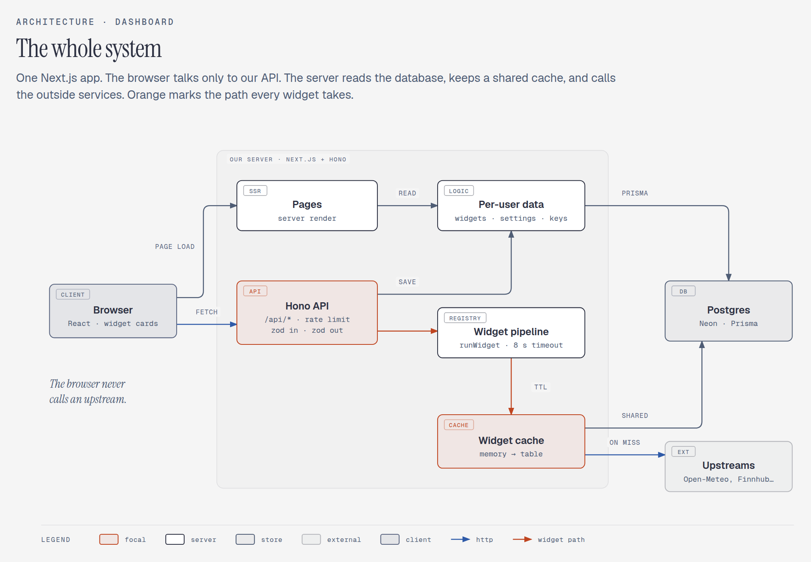

**One widget fetch.** Every card gets its data the same way: the options are checked, the cache
answers, and the outside service is only called on a miss.

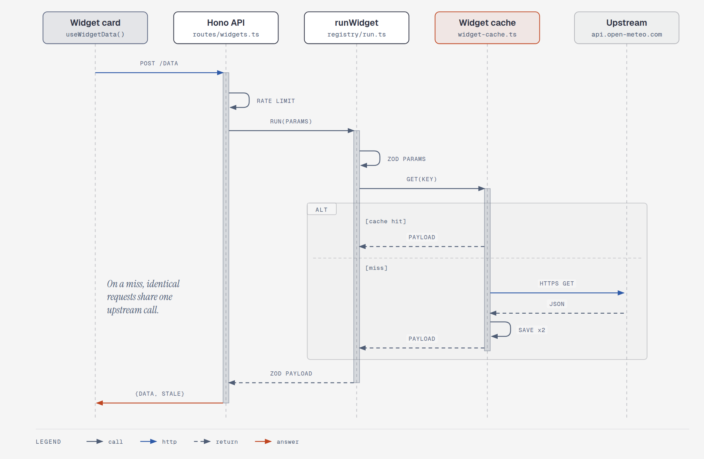

## Project structure

```
app/          pages (dashboard, services, settings, admin, log in and register) and the /api entry
components/   widget cards, the dashboard, settings, admin, shadcn/ui parts
lib/          browser and shared code: the API client, the timer, better-auth and its checks
server/       the Hono API, the widget registry, services, cache, rate limit, encryption
prisma/       database schema and migrations
tests/        Vitest tests: sign up, log in, password reset, admin rules, keys, subscriptions
```
